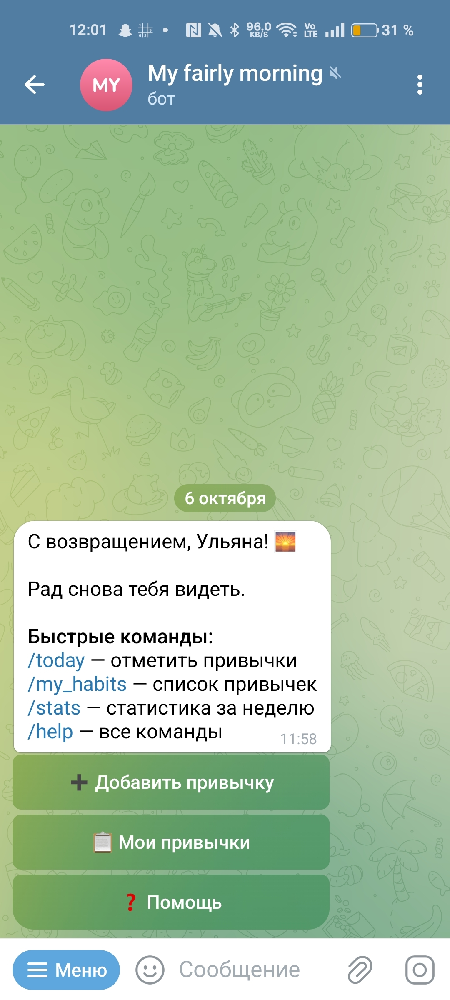
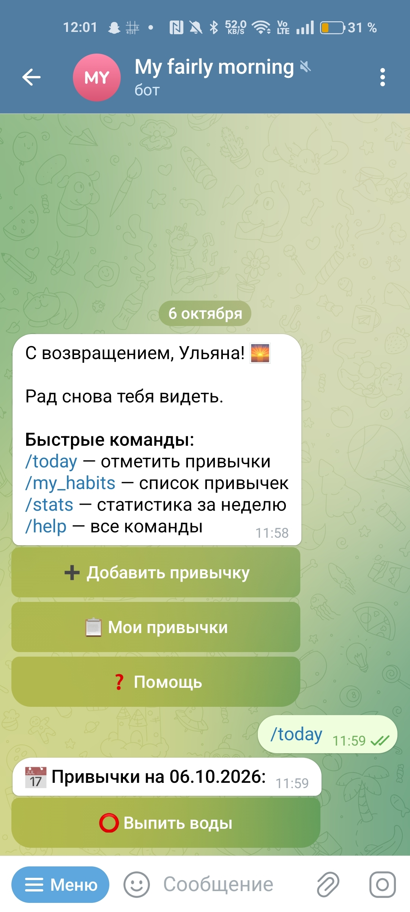
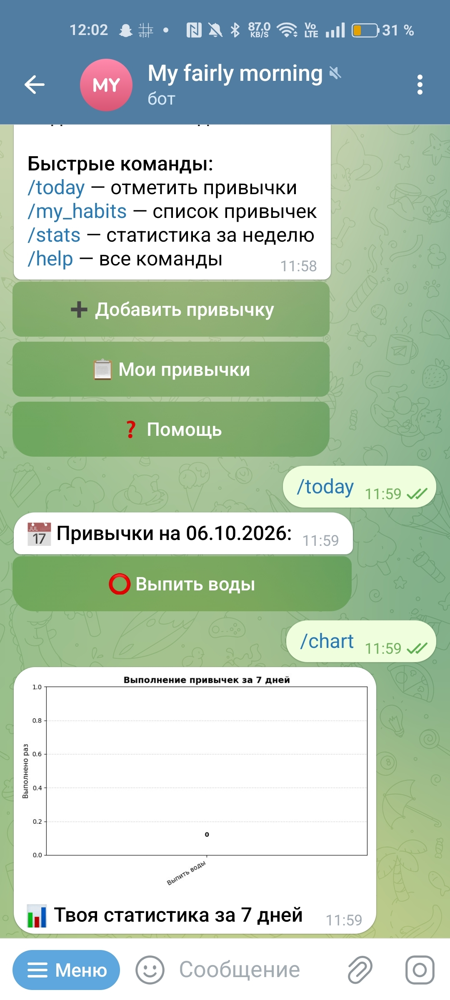
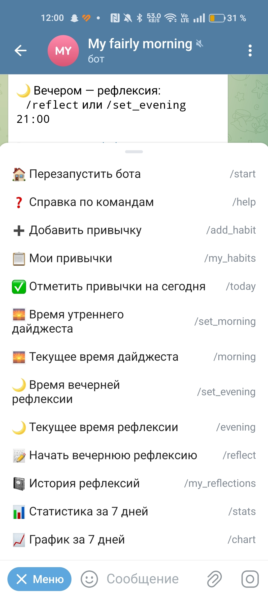

[](https://github.com/ylik-mal/my-fairly-morning/actions/workflows/tests.yml)

# My Fairly Morning 🌅

Telegram-бот для отслеживания привычек и вечерней рефлексии.

<p align="center">
  
  
</p>

<p align="center">
  
</p>

## Возможности

- ✅ Добавление привычек (`/add_habit`)
- ✅ Просмотр списка привычек (`/my_habits`)
- ✅ Ежедневные отметки (`/today` с кнопками «Сделано / Пропустить»)
- ✅ Утренний дайджест (`/set_morning HH:MM`)
- ✅ Вечерняя рефлексия (FSM-диалог, `/reflect`)
- ✅ История рефлексий (`/my_reflections`)
- ✅ Статистика за 7 дней (`/stats`)
- ✅ Графики выполнения (`/chart`)
- ✅ Интерактивное меню (`/menu` с разделами)
- ✅ Слово дня с 5 темами (`/word`, `/topics`)
- ✅ Тематические синонимы и английские переводы
- ✅ Ежедневная печенька с мотивацией (`/cookie`)
- ✅ Утренний дайджест с привычками, словом дня и печенькой
- ✅ Серия дней подряд (streak) по каждой привычке
- ✅ Экспорт данных в CSV (`/export` — привычки и рефлексии)

## Меню команд

<p align="center">
  
</p>

## Стек

- Python 3.12
- aiogram 3.x
- SQLite (aiosqlite)
- APScheduler
- matplotlib
- pytest + pytest-asyncio
- GitHub Actions (CI)
- csv (экспорт данных)

## Слово дня

Бот присылает одно слово в день из выбранной темы — с синонимами (от простого к сложному) и английскими переводами.

### Доступные темы

- 🎭 Эмоции и чувства — 29 слов
- 💪 Характер человека — 32 слова
- 🌿 Природа и погода — 30 слов
- 🧠 Мышление и интеллект — 30 слов
- ✨ Красота и эстетика — 30 слов

**Всего: 151 слово.** Смена темы: `/topics`.

### Пример
📚 Слово дня: КРАСИВЫЙ

• красивый → милый → пригожий → живописный → великолепный → божественный

🇬🇧 beautiful / pretty / handsome / picturesque / magnificent / gorgeous


## Печенька с предсказанием

Команда `/cookie` присылает случайное мотивационное предсказание из 30 фраз. Печенька автоматически добавляется в утренний дайджест.

### Пример
🥠 Твоё предсказание на сегодня:

«Сегодня отличный день, чтобы начать что-то новое.
Не откладывай мечты — сделай первый шаг!»

🍀 Удачного дня!


## Экспорт данных

Команда `/export` позволяет выгрузить свои данные в формате CSV для анализа в Excel или Google Sheets.

### Что можно экспортировать

- **📋 Привычки** — название, выполнено за 30 дней, пропущено, процент, отметка сегодня.
- **📝 Рефлексии** — дата, оценка дня, что удалось, что не получилось.

### Пример
/export

Бот предложит две кнопки — выбери нужный тип данных, и получишь файл.

## Docker

### Запуск через Docker

1. Создать `.env` на основе `.env.example`:
BOT_TOKEN=your_telegram_bot_token_here
PROXY=socks5://IP:PORT

2. Запустить:
```bash
docker compose up -d

3. Логи:
docker compose logs -f

4. Остановить
docker compose down

Установка
Требования
Python 3.12

Telegram Bot Token (получить у @BotFather)

Шаги
1. Клонировать репозиторий:
git clone https://github.com/ylik-mal/my-fairly-morning.git
cd my-fairly-morning

2. Создать виртуальное окружение:
python -m venv venv
.\venv\Scripts\Activate.ps1    # Windows
source venv/bin/activate        # Mac/Linux

3. Установить зависимоть:
pip install -r requirements.txt

4. Создать .env на основе .env.example:
BOT_TOKEN=your_telegram_bot_token_here
PROXY=socks5://IP:PORT

5. Запустить:
python main.py

Работа через прокси
В регионах, где api.telegram.org недоступен, бот поддерживает SOCKS5-прокси. Укажите прокси в .env:
PROXY=socks5://IP:PORT

Документация

ROADMAP.md — план развития проекта
PROGRESS.md — трекер активности
IDEAS.md — идеи для улучшения
