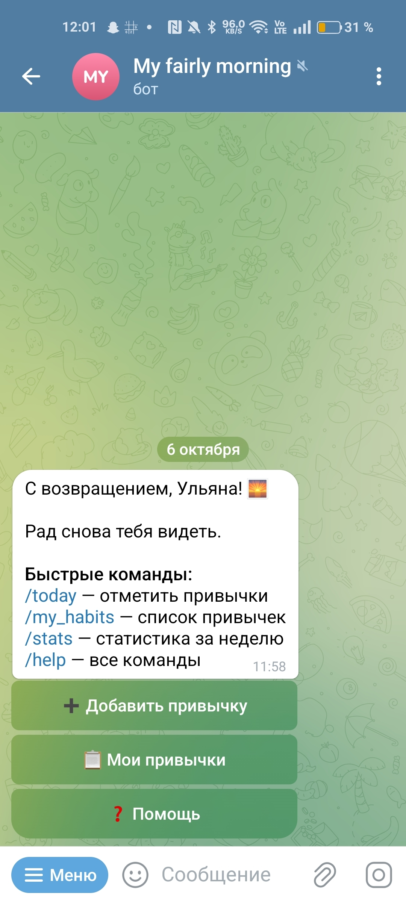
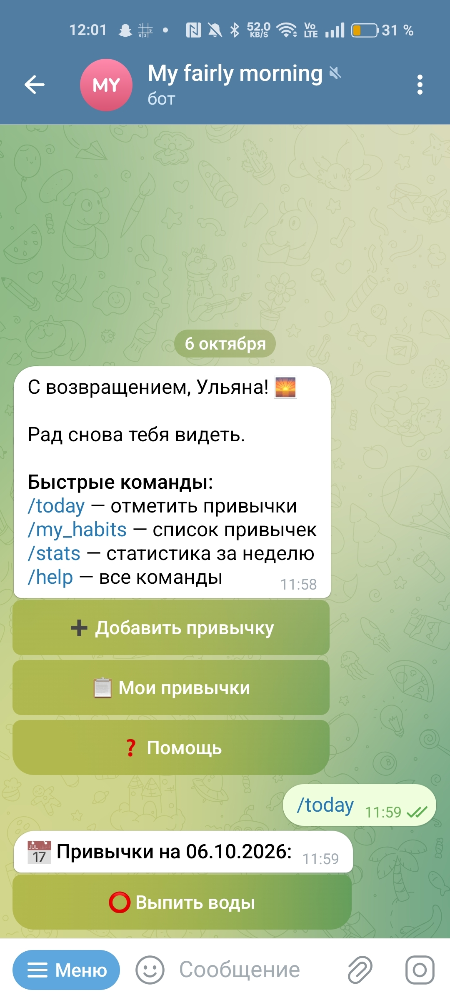
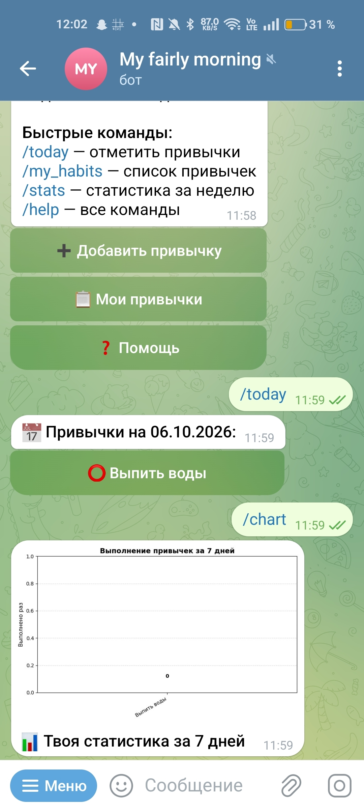
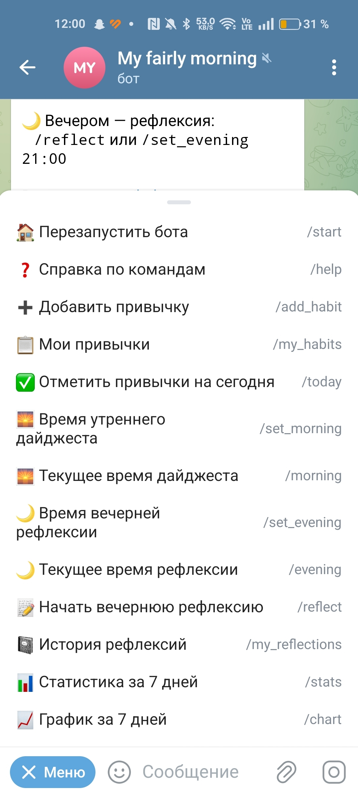
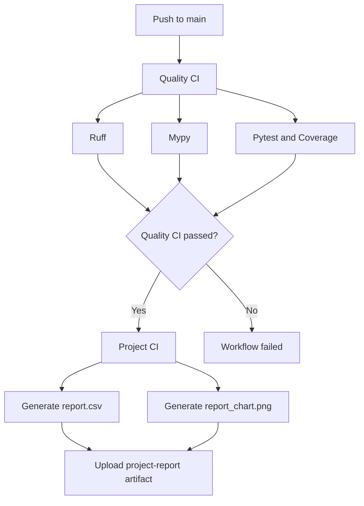

[](https://github.com/ylik-mal/my-fairly-morning/actions/workflows/tests.yml)


# My Fairly Morning 🌅

Telegram-бот для отслеживания привычек, вечерней рефлексии и личностного развития.

My Fairly Morning помогает формировать полезные привычки, анализировать прошедший день, отслеживать собственный прогресс и расширять словарный запас.

## 💡 Idea

My Fairly Morning is a Telegram bot designed to combat the chaos of daily routines. It combines three psychological concepts:

1. **Habit tracking** — building discipline through daily check-ins.
2. **Evening reflection** — developing mindfulness and self-analysis.
3. **Vocabulary expansion** — learning daily words with synonyms and English translations.

The bot doesn't just send reminders; it creates a supportive environment for personal growth through gamification, progress visualization, streaks, and daily motivational fortune cookies.

<p align="center">
  
  
</p>

<p align="center">
  
</p>

## 📑 Содержание

- [Возможности](#-возможности)
- [Меню команд](#-меню-команд)
- [Слово дня](#-слово-дня)
- [Печенька с предсказанием](#-печенька-с-предсказанием)
- [Экспорт данных](#-экспорт-данных)
- [Технологический стек](#-технологический-стек)
- [Архитектура проекта](#-архитектура-проекта)
- [Установка и запуск](#-установка-и-запуск)
- [Docker](#-docker)
- [Работа через прокси](#-работа-через-прокси)
- [Тестирование](#-тестирование)
- [CI/CD](#-cicd)
- [How to verify CI/CD](#-how-to-verify-cicd)
- [AI Models & Tools Declaration](#-ai-models--tools-declaration)
- [Документация](#-документация)

## ✨ Возможности

### Отслеживание привычек

- Добавление и удаление привычек.
- Просмотр списка активных привычек.
- Ежедневные отметки «Сделано» и «Пропустить».
- Персональный утренний дайджест.
- Настройка времени уведомлений.

### Вечерняя рефлексия

- Интерактивный диалог на основе FSM.
- Оценка прошедшего дня.
- Анализ достижений и трудностей.
- Просмотр истории рефлексий.

### Статистика и аналитика

- Статистика выполнения привычек за 7 дней.
- Визуализация прогресса с помощью графиков.
- Экспорт привычек и рефлексий в CSV.

### Личностное развитие

- Слово дня с синонимами и английскими переводами.
- 167 слов в 7 тематических категориях.
- 35 мотивационных предсказаний.
- Удобное интерактивное меню.

## 📱 Меню команд

<p align="center">
  
</p>

| Команда | Описание |
| --- | --- |
| `/start` | Запуск бота и приветствие |
| `/menu` | Интерактивное меню |
| `/help` | Справка по командам |
| `/add_habit` | Добавить привычку |
| `/my_habits` | Просмотреть список привычек |
| `/delete_habit` | Удалить привычку |
| `/today` | Отметить выполнение привычек |
| `/set_morning HH:MM` | Настроить время утреннего дайджеста |
| `/set_evening HH:MM` | Настроить время вечерней рефлексии |
| `/reflect` | Начать вечернюю рефлексию |
| `/my_reflections` | Просмотреть историю рефлексий |
| `/stats` | Получить статистику за 7 дней |
| `/chart` | Построить график выполнения привычек |
| `/word` | Получить слово дня |
| `/topics` | Выбрать тему для слова дня |
| `/cookie` | Получить мотивационное предсказание |
| `/export` | Экспортировать данные в CSV |

## 📚 Слово дня

Бот предлагает ежедневно изучать новое слово из выбранной тематической категории.

Каждое слово сопровождается синонимами, расположенными от простых к более сложным, и английскими переводами.

### Доступные темы

| Тема | Количество слов |
| --- | ---: |
| 🎭 Эмоции и чувства | 29 |
| 💪 Характер человека | 32 |
| 🌿 Природа и погода | 30 |
| 🧠 Мышление и интеллект | 30 |
| ✨ Красота и эстетика | 30 |
| 💻 Технологии | 8 |
| 🍔 Еда и напитки | 8 |
| **Всего** | **167** |

Для смены тематической категории используется команда `/topics`.

### Пример

```text
📚 Слово дня: КРАСИВЫЙ

красивый → милый → пригожий → живописный
→ великолепный → божественный

🇬🇧 beautiful / pretty / handsome /
picturesque / magnificent / gorgeous
```

## 🥠 Печенька с предсказанием

Команда `/cookie` позволяет получить случайное мотивационное предсказание из коллекции из 35 фраз.

Печенька также автоматически добавляется в утренний дайджест.

### Пример

```text
🥠 Твоё предсказание на сегодня:

«Сегодня отличный день, чтобы начать что-то новое.
Не откладывай мечты — сделай первый шаг!»

🍀 Удачного дня!
```

## 📊 Экспорт данных

Команда `/export` позволяет выгрузить персональные данные в формате CSV для дальнейшего анализа в Microsoft Excel или Google Sheets.

### Экспорт привычек

- Название привычки.
- Количество выполнений за последние 30 дней.
- Количество пропусков.
- Процент выполнения.
- Статус выполнения за текущий день.

### Экспорт рефлексий

- Дата рефлексии.
- Оценка дня.
- Что удалось.
- Что не получилось.

### Как использовать

1. Отправить команду `/export`.
2. Выбрать тип данных: привычки или рефлексии.
3. Получить CSV-файл непосредственно в Telegram.

## 🛠 Технологический стек

| Технология | Назначение |
| --- | --- |
| Python 3.12 | Основной язык программирования |
| aiogram 3.x | Асинхронная работа с Telegram Bot API |
| SQLite | Хранение пользовательских данных |
| aiosqlite | Асинхронная работа с базой данных |
| APScheduler | Планирование уведомлений и дайджестов |
| matplotlib | Построение графиков |
| pytest | Автоматизированное тестирование |
| pytest-asyncio | Тестирование асинхронного кода |
| pytest-cov | Анализ покрытия кода тестами |
| ruff | Линтинг и проверка качества кода |
| mypy | Статическая проверка типов |
| GitHub Actions | Автоматизация CI/CD |
| Docker | Контейнеризация приложения |
| Docker Compose | Управление запуском контейнера |

## 🏗 Архитектура проекта

Проект имеет модульную архитектуру с разделением обработчиков команд, работы с базой данных, планировщика задач и вспомогательных функций.

```text
my_fairly_morning/
├── app/
│   ├── config.py               # Загрузка конфигурации из .env
│   │
│   ├── database/
│   │   └── db.py               # SQL-запросы и работа с SQLite
│   │
│   ├── handlers/               # Обработчики команд
│   │   ├── start.py            # Приветствие и запуск бота
│   │   ├── habits.py           # Управление привычками
│   │   ├── checkins.py         # Ежедневные отметки
│   │   ├── settings.py         # Настройка уведомлений
│   │   ├── reflection.py       # FSM-диалог рефлексии
│   │   ├── stats.py            # Статистика и графики
│   │   ├── words.py            # Слово дня и темы
│   │   ├── cookies.py          # Мотивационные предсказания
│   │   ├── export.py           # Экспорт данных
│   │   ├── menu.py             # Интерактивное меню
│   │   └── help.py             # Справка по командам
│   │
│   ├── keyboards/
│   │   └── checkin.py          # Inline-клавиатуры
│   │
│   ├── scheduler/
│   │   ├── runner.py           # Запуск APScheduler
│   │   └── tasks.py            # Запланированные уведомления
│   │
│   └── utils/
│       ├── words.py            # 167 слов в 7 категориях
│       ├── cookies.py          # 35 мотивационных фраз
│       ├── charts.py           # Генерация графиков
│       └── csv_export.py       # Формирование CSV-файлов
│
├── scripts/
│   └── generate_report.py      # Генерация отчётов Project CI
│
├── tests/                      # 26 автоматизированных тестов
├── docs/
│   └── screenshots/            # Скриншоты интерфейса
│
├── Dockerfile                  # Конфигурация Docker-образа
├── docker-compose.yml          # Запуск через Docker Compose
├── requirements.txt            # Зависимости проекта
├── mypy.ini                    # Настройки проверки типов
├── .env.example                # Пример конфигурации
├── main.py                     # Точка входа приложения
├── ROADMAP.md                  # План развития
├── PROGRESS.md                 # Трекер активности
├── IDEAS.md                    # Идеи для развития
├── DEPLOY.md                   # Инструкция по развёртыванию
└── README.md                   # Документация проекта
```

### Основные компоненты

| Компонент | Ответственность |
| --- | --- |
| `handlers` | Обработка команд и взаимодействие с пользователем |
| `database` | Хранение и получение данных |
| `keyboards` | Формирование интерактивных клавиатур |
| `scheduler` | Выполнение запланированных задач |
| `utils` | Вспомогательные функции и обработка данных |
| `tests` | Проверка корректности работы приложения |
| `scripts` | Автоматизация формирования отчётов |

## 🚀 Установка и запуск

### Требования

- Python 3.12.
- Git.
- Telegram Bot Token, полученный через [@BotFather](https://t.me/BotFather).

### 1. Клонирование репозитория

```bash
git clone https://github.com/ylik-mal/my-fairly-morning.git
cd my-fairly-morning
```

### 2. Создание виртуального окружения

```bash
python -m venv venv
```

Активация виртуального окружения:

**Windows (PowerShell):**

```powershell
.\venv\Scripts\Activate.ps1
```

**macOS / Linux:**

```bash
source venv/bin/activate
```

### 3. Установка зависимостей

```bash
pip install -r requirements.txt
```

### 4. Настройка переменных окружения

Создайте файл `.env` на основе `.env.example`.

**Windows (PowerShell):**

```powershell
Copy-Item .env.example .env
```

**macOS / Linux:**

```bash
cp .env.example .env
```

Укажите необходимые параметры:

```dotenv
BOT_TOKEN=your_telegram_bot_token_here
PROXY=
```

| Переменная | Описание | Обязательная |
| --- | --- | --- |
| `BOT_TOKEN` | Токен Telegram-бота | Да |
| `PROXY` | Адрес SOCKS5-прокси | Нет |

> [!IMPORTANT]
> Не публикуйте файл `.env` и токен Telegram-бота в открытом репозитории. Конфиденциальные данные должны храниться в переменных окружения.

### 5. Запуск приложения

```bash
python main.py
```

После запуска откройте своего бота в Telegram и отправьте команду `/start`.

## 🐳 Docker

Проект поддерживает запуск в контейнере с помощью Docker и Docker Compose.

### Требования

- Docker.
- Docker Compose.
- Настроенный файл `.env`.

### Запуск

```bash
docker compose up -d
```

### Просмотр логов

```bash
docker compose logs -f
```

### Проверка состояния контейнера

```bash
docker compose ps
```

### Перезапуск

```bash
docker compose restart
```

### Остановка

```bash
docker compose down
```

Подробная инструкция по развёртыванию на сервере находится в файле [DEPLOY.md](DEPLOY.md).

## 🌐 Работа через прокси

В регионах, где прямое подключение к `api.telegram.org` недоступно, бот поддерживает подключение через SOCKS5-прокси.

Для настройки укажите адрес прокси в файле `.env`:

```dotenv
PROXY=socks5://IP:PORT
```

Если прокси не требуется, оставьте значение переменной пустым:

```dotenv
PROXY=
```

## 🧪 Тестирование

Для проверки качества и корректности работы приложения используются автоматизированные тесты, линтер и статический анализатор типов.

В проекте реализовано **26 автоматизированных тестов**.

### Запуск тестов

```bash
python -m pytest tests/ -v
```

### Проверка покрытия кода тестами

```bash
python -m pytest tests/ --cov=app --cov-report=term-missing
```

### Проверка качества кода

```bash
ruff check .
```

### Статическая проверка типов

```bash
mypy app
```

## ⚙️ CI/CD

В проекте настроен автоматизированный CI/CD-процесс на базе GitHub Actions.

Процесс состоит из двух последовательных этапов: **Quality CI** и **Project CI**.

### Quality CI

Запускается при каждом push в ветку `main`.

Включает:

- Проверку качества кода с помощью `ruff`.
- Статическую проверку типов с помощью `mypy`.
- Запуск 26 автоматизированных тестов с помощью `pytest`.
- Формирование отчёта о покрытии кода тестами.

### Project CI

Запускается после успешного прохождения Quality CI.

Включает:

- Запуск скрипта `scripts/generate_report.py`.
- Генерацию отчёта `report.csv`.
- Генерацию графика `report_chart.png`.
- Загрузку результатов в качестве артефакта GitHub Actions.

### Схема CI/CD



### Артефакты

| Файл | Назначение |
| --- | --- |
| `report.csv` | Автоматически сформированный отчёт |
| `report_chart.png` | Графическое представление результатов |
| `project-report` | Артефакт, содержащий отчёт и график |

## 🛡️ How to verify CI/CD

To verify the automated workflows:

1. Open the [Actions](https://github.com/ylik-mal/my-fairly-morning/actions) tab in this repository.
2. Select the latest **Tests & Report** workflow run.
3. Check that the **Quality CI** job has completed successfully.
4. Review the test results, code coverage, linter results, and type-checking results in the job summary or logs.
5. Check that the **Project CI** job has completed successfully.
6. Scroll down to the **Artifacts** section.
7. Download the `project-report` artifact.

The downloaded artifact contains:

- `report.csv` — an automatically generated report.
- `report_chart.png` — a graphical representation of the report data.

## 🤖 AI Models & Tools Declaration

As per the assignment requirements, AI tools were used during the development of this project.

## 🛠️ Response to CI Findings

During the CI setup, several issues were identified and fixed:

- **63 linter errors** (imports, duplicates, unused variables) — fixed with `ruff`.
- **58 mypy errors** (Optional types in aiogram) — resolved by configuring `mypy.ini`.
- **Duplicate functions** in `start.py`, `checkins.py`, `stats.py` — removed.
- **Missing imports** — added.

All fixes are visible in the commit history. Final CI runs pass with **zero errors**.

### Tools used

| Tool | Purpose |
| --- | --- |
| ChatGPT | Code assistance, explanations, refactoring, and testing support |
| DeepSeek | Code assistance and alternative implementation suggestions |
| ruff | Linting and code quality checks |
| mypy | Static type checking |
| GitHub Actions | CI/CD automation |

### Self-contribution vs AI

While AI helped with boilerplate code, formatting, and writing some tests, the architecture, database schema, FSM dialogue logic, and CI/CD setup were designed and implemented independently.

My personal contribution includes:

- Designing the modular project architecture.
- Designing and implementing the database schema.
- Implementing the FSM-based reflection dialogue.
- Configuring the CI/CD pipeline.
- Configuring `mypy.ini`.
- Resolving more than 60 linter errors.
- Ensuring that the project passes all 26 automated tests.

AI-generated suggestions were reviewed, adapted, and tested before being integrated into the project.

**AI was used as a pair-programmer, not a replacement for independent development.**

## 📖 Документация

| Документ | Описание |
| --- | --- |
| [README.md](README.md) | Основная документация проекта |
| [ROADMAP.md](ROADMAP.md) | План развития проекта на 10 недель |
| [PROGRESS.md](PROGRESS.md) | Трекер активности и прогресса разработки |
| [IDEAS.md](IDEAS.md) | Идеи для дальнейшего развития |
| [DEPLOY.md](DEPLOY.md) | Инструкция по развёртыванию на VPS |

Документация функций представлена в docstrings с использованием рекомендаций PEP 257 и Google Style.

---

<p align="center">
  <b>My Fairly Morning 🌅</b>
  <br/>
  Small habits. Meaningful reflections. Better days.
</p>
