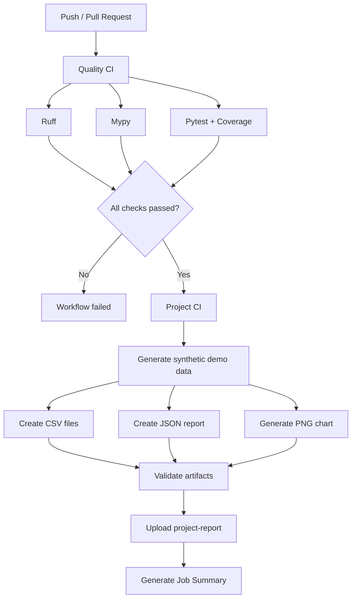

# My Fairly Morning 🌅

[](https://github.com/ylik-mal/my-fairly-morning/actions/workflows/tests.yml)


**My Fairly Morning** — Telegram-бот для формирования полезных привычек, ежедневной рефлексии и личностного развития.

Проект помогает организовать повседневную жизнь, отслеживать прогресс, анализировать результаты и постепенно формировать устойчивые привычки.

## ✨ Возможности

### Отслеживание привычек
- Добавление и удаление привычек.
- Ежедневная отметка выполнения.
- Возможность пропустить выполнение.
- Подсчёт серий выполнения (streak).
- Персональная статистика.

### Ежедневная рефлексия
- Интерактивный диалог с пользователем.
- Оценка прошедшего дня.
- Фиксация достижений и трудностей.
- История предыдущих рефлексий.

### Уведомления
- Настройка времени утреннего дайджеста.
- Настройка времени вечерней рефлексии.
- Автоматические уведомления.

### Аналитика
- Статистика за последние 7 дней.
- Графики выполнения привычек.
- Экспорт данных в CSV.
- Формирование аналитических отчётов.

### Личностное развитие
- Слово дня.
- Тематические категории слов.
- Мотивационные предсказания.

## 🛠 Технологический стек

| Технология | Назначение |
|---|---|
| Python 3.12 | Основной язык |
| aiogram 3 | Telegram Bot API |
| SQLite | Хранение данных |
| aiosqlite | Асинхронная работа с БД |
| APScheduler | Планирование уведомлений |
| matplotlib | Визуализация данных |
| pytest | Автоматизированные тесты |
| pytest-asyncio | Асинхронное тестирование |
| pytest-cov | Анализ покрытия |
| Ruff | Линтинг |
| Mypy | Статическая проверка типов |
| GitHub Actions | CI/CD |

## 🏗 Архитектура проекта

Проект построен на модульной архитектуре.

```text
my_fairly_morning/
│
├── app/
│   ├── config.py
│   │
│   ├── database/
│   │   ├── __init__.py
│   │   ├── db.py
│   │   └── models.py
│   │
│   ├── handlers/
│   │   ├── start.py
│   │   ├── habits.py
│   │   ├── checkins.py
│   │   ├── settings.py
│   │   ├── reflection.py
│   │   ├── stats.py
│   │   ├── words.py
│   │   ├── cookies.py
│   │   ├── export.py
│   │   ├── menu.py
│   │   └── help.py
│   │
│   ├── keyboards/
│   │   ├── checkin.py
│   │   └── inline.py
│   │
│   ├── scheduler/
│   │   ├── runner.py
│   │   └── tasks.py
│   │
│   └── utils/
│       ├── charts.py
│       ├── cookies.py
│       ├── csv_export.py
│       └── words.py
│
├── scripts/
│   ├── generate_report.py
│   ├── demo_report.py
│   └── project_summary.py
│
├── tests/
│   ├── conftest.py
│   ├── test_database.py
│   ├── test_export.py
│   ├── test_charts.py
│   └── ...
│
├── .github/
│   └── workflows/
│       └── tests.yml
│
├── main.py
├── requirements.txt
├── .env.example
├── Dockerfile
├── docker-compose.yml
├── README.md
├── ROADMAP.md
├── PROGRESS.md
├── IDEAS.md
└── DEPLOY.md
```

### Основные компоненты

| Компонент | Ответственность |
|---|---|
| handlers | Обработка команд и действий пользователя |
| database | Работа с SQLite |
| keyboards | Интерактивные клавиатуры |
| scheduler | Планирование уведомлений |
| utils | Вспомогательные функции |
| scripts | Генерация аналитических отчётов |
| tests | Проверка корректности работы |

## 🚀 Установка и запуск

### Требования

- Python 3.12
- Git
- Telegram Bot Token от [@BotFather](https://t.me/BotFather)

### 1. Клонирование проекта

```bash
git clone https://github.com/ylik-mal/my-fairly-morning.git
cd my-fairly-morning
```

### 2. Создание виртуального окружения

```bash
python -m venv venv
```

Активация в Windows PowerShell:

```powershell
.\venv\Scripts\Activate.ps1
```

### 3. Установка зависимостей

```bash
python -m pip install -r requirements.txt
```

### 4. Настройка окружения

Создайте файл `.env`:

```powershell
Copy-Item .env.example .env
```

Укажите настройки:

```dotenv
BOT_TOKEN=your_telegram_bot_token
DB_PATH=bot.db
PROXY=
```

| Переменная | Описание |
|---|---|
| BOT_TOKEN | Токен Telegram-бота |
| DB_PATH | Путь к базе данных |
| PROXY | Необязательный адрес прокси |

**Важно:** не публикуйте токен бота и файл `.env` в открытом репозитории.

### 5. Запуск

```bash
python main.py
```

После запуска откройте бота в Telegram и отправьте `/start`.

## 🧪 Тестирование и качество кода

Для проверки проекта используются три основных инструмента:

- Ruff — проверка стиля и качества кода.
- Mypy — статическая проверка типов.
- Pytest — автоматизированное тестирование.

### Запуск проверок

Проверка Ruff:

```bash
ruff check .
```

Проверка типов:

```bash
mypy app
```

Запуск всех тестов:

```bash
python -m pytest -v
```

Запуск тестов с анализом покрытия:

```bash
python -m pytest -q --cov=app --cov-report=term-missing
```


### Результаты последней проверки

Последний подтверждённый успешный запуск GitHub Actions выполнен **27 ноября 2026 года** для коммита `06aa212`.

- [Quality CI — проверки кода, типов и тестов](https://github.com/ylik-mal/my-fairly-morning/actions/runs/45931297710/job/140284299089)
- [Project CI — генерация и проверка аналитического отчёта](https://github.com/ylik-mal/my-fairly-morning/actions/runs/45931297710/job/140284485659)
- [Полный запуск Tests & Report](https://github.com/ylik-mal/my-fairly-morning/actions/runs/45931297710)

| Проверка | Результат |
|---|---|
| Ruff | Passed |
| Mypy | Passed |
| Pytest | 236 passed |
| Общее покрытие кода | 99% |

Оба этапа завершились успешно. Project CI сформировал и проверил все четыре выходных файла: `habits.csv`, `reflections.csv`, `report.json` и `report_chart.png`.

Подробные логи, отчёты и результаты запуска доступны в артефактах GitHub Actions.

## ⚙️ CI/CD — GitHub Actions

В проекте настроены два автоматизированных CI/CD-процесса.

Workflow находится в:

`.github/workflows/tests.yml`

Запуск происходит при:
- Push в `main`.
- Pull Request в `main`.
- Ручном запуске через GitHub Actions.

### 1. Quality CI

Первый этап отвечает за качество исходного кода.

Включает:

1. Установку зависимостей.
2. Проверку Ruff.
3. Проверку Mypy.
4. Запуск Pytest.
5. Сбор покрытия кода.
6. Формирование логов и отчётов.

Результаты сохраняются в артефакт `quality-report`.

### 2. Project CI

Второй этап запускается только после успешного завершения Quality CI.

Он отвечает за демонстрацию аналитических возможностей проекта.

Включает:

1. Запуск `scripts/demo_report.py`.
2. Создание демонстрационной базы данных с синтетическими данными.
3. Генерацию CSV-файлов.
4. Формирование JSON-отчёта.
5. Построение графика.
6. Проверку корректности созданных файлов.
7. Формирование итоговой сводки GitHub Actions.

### Схема CI/CD



## 📊 Демонстрационная аналитика

Для демонстрации возможностей аналитической части проекта реализован отдельный сценарий:

```bash
python scripts/demo_report.py
```

Он создаёт отчёт на основе синтетических данных.

Демонстрационный период составляет 7 дней.

Пример результатов:

| Метрика | Значение |
|---|---:|
| Период | 7 дней |
| Привычки | 4 |
| Выполнено | 21 |
| Пропущено | 7 |
| Выполнение | 75% |
| Рефлексии | 7 |
| Средняя оценка дня | 8.0/10 |

### Пример статистики привычек

| Привычка | Выполнено | Пропущено |
|---|---:|---:|
| Вода | 7 | 0 |
| Чтение | 5 | 2 |
| Спорт | 3 | 4 |
| Английский | 6 | 1 |

### Генерируемые артефакты

После запуска создаётся директория `demo_artifacts/`.

| Файл | Назначение |
|---|---|
| habits.csv | Статистика привычек |
| reflections.csv | История рефлексий |
| report.json | Структурированный аналитический отчёт |
| report_chart.png | График выполнения привычек |

Данные демонстрации являются синтетическими и не содержат персональную информацию реальных пользователей.

### Генерация сводки проекта

```bash
python scripts/project_summary.py
```

Скрипт формирует Markdown-сводку с основными метриками и статистикой привычек.

## 📁 Артефакты GitHub Actions

После успешного выполнения workflow доступны два артефакта.

**quality-report**
- Лог Ruff.
- Лог Mypy.
- Результаты Pytest.
- Отчёт о покрытии.
- JUnit XML.

**project-report**
- habits.csv.
- reflections.csv.
- report.json.
- report_chart.png.
- demo-report.log.

Срок хранения артефактов — 90 дней.

### Как проверить CI

1. Откройте вкладку [Actions](https://github.com/ylik-mal/my-fairly-morning/actions).
2. Выберите последний запуск `Tests & Report`.
3. Проверьте успешность `Quality CI`.
4. Проверьте успешность `Project CI`.
5. Посмотрите итоговые сводки.
6. Скачайте нужный артефакт в разделе Artifacts.

## 🤖 Использование AI-инструментов и моделей

В процессе разработки AI-инструменты использовались как вспомогательные средства:

| Инструмент | Назначение |
|---|---|
| ChatGPT | Объяснение кода, помощь с тестированием и отладкой |
| DeepSeek | Дополнительные варианты реализации и анализ |

**Декларация моделей:** приложение My Fairly Morning не использует встроенные ML/LLM-модели и не отправляет пользовательские данные во внешние AI-модели. ChatGPT и DeepSeek применялись только при разработке — для консультаций, анализа и поиска вариантов решений.

Ruff, Mypy и GitHub Actions используются отдельно как инструменты автоматизированной проверки и CI/CD, а не как AI-модели.

Предложения AI-инструментов проверялись, адаптировались и тестировались перед использованием в проекте.

## 📖 Дополнительная документация

| Документ | Описание |
|---|---|
| ROADMAP.md | План развития проекта |
| PROGRESS.md | Трекер активности |
| IDEAS.md | Идеи для развития |
| DEPLOY.md | Инструкция по развёртыванию |

---

<p align="center">
  <b>My Fairly Morning 🌅</b>
  <br>
  Small habits. Meaningful reflections. Better days.
</p>
